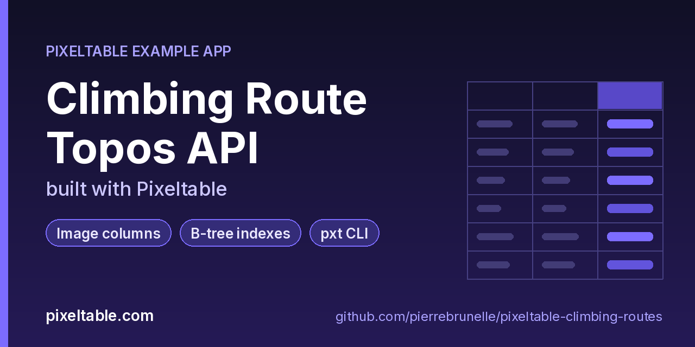

<!-- pixeltable-example-app: 20261009-climbing-routes -->
# Climbing Route Topos API built with Pixeltable



[](https://codespaces.new/pierrebrunelle/pixeltable-climbing-routes?quickstart=1)
[](https://pixeltable.com)
[](https://pypi.org/project/pixeltable/)
[](https://github.com/pixeltable/pixeltable)
[](LICENSE)

A registry of climbing routes and their topo photos. Upload a topo with the route name, crag, YDS grade and style, and Pixeltable stores the image, then derives a **96x128 thumbnail** and a **grayscale copy** as media computed columns. A chain of PIL-based UDFs tags the aspect ratio, the dominant color channel, a coarse grade band and a combined topo label. B-tree indexes on crag, grade, style and band back the lookup queries. The API accepts multipart uploads, analyzes a topo without storing it, lists routes by crag or grade band, and serves a route's thumbnail as an image file.

[Pixeltable](https://pixeltable.com) is open-source, Python-native **multimodal AI data infrastructure**: tables, incremental computed columns, UDFs, indexes and serving in one library, running locally or on Pixeltable Cloud.

> ⭐ **Like this example?** Star [pixeltable/pixeltable](https://github.com/pixeltable/pixeltable) on GitHub. It helps other developers find it.

## What this example shows

- **Multimodal media columns** with configurable media destinations
- **B-tree indexes** declared on the model (`__indexes__`) back the lookup queries
- **`pxt` CLI and local dashboard** for exploring tables and computed columns
- **Incremental computed columns** powered by plain Python UDFs (`@pxt.udf`)
- **FastAPI serving**: one `FastAPIRouter` turns tables and `@pxt.query` functions into typed REST routes (insert, update, delete, compute and query) with OpenAPI docs
- **Importable UDF module**: UDFs live in `udfs.py`; tables, queries and routes live together in `app.py` (Pixeltable resolves UDFs by module path)
- **`pixeltable.toml`** declares a local database and a **Pixeltable Cloud** database, so the same code deploys with `pxt db update`

## Where the images go

| Column | Kind | Stored in |
|--------|------|-----------|
| `topo` | uploaded input | the database's input media store |
| `thumb = topo.resize((96, 128))` | generated | the database's output media store |
| `gray = topo.convert('L')` | generated | the database's output media store |

Media placement is configuration, not code. By default everything stays in the local media store (or the database's home bucket on Pixeltable Cloud). To send generated files somewhere else, set it per database in `pixeltable.toml`:

```toml
settings = { output_media_dest = 's3://<your-bucket>/climbing/' }
```

On Pixeltable Cloud 0.7.16+, home-bucket media addresses use the canonical form `pxt://<org>:<db>/buckets/home/...` (legacy `pxtfs://` reads still work).

## Indexes

`Routes` declares four B-tree indexes (`crag`, `grade`, `style`, `band`) that back the `/routes/by-crag` and `/routes/by-band` query routes.

## What's inside

| File | What it is |
|------|------------|
| `.devcontainer/devcontainer.json` | GitHub Codespaces / Dev Container config: Python 3.12, installs `requirements.txt`, forwards port 8000 |
| `.github/social-preview.png` | Social preview image (1280x640) |
| `CITATION.cff` | Citation metadata (authors, license, release date, keywords) |
| `app.py` | The app: tables declared as Python classes, `@pxt.query` functions, and the `FastAPIRouter` routes |
| `client_demo.py` | Call every route of the climbing-route topo API |
| `data/arete-sunset.png` | Sample data |
| `data/crack-line.png` | Sample data |
| `data/overhang-crux.png` | Sample data |
| `data/slab-morning.png` | Sample data |
| `pixeltable.toml` | Project config: the local database plus a Pixeltable Cloud database (sizing, deploy excludes) |
| `seed.py` | Seed a few climbing routes with topo images (run after schema update) |
| `udfs.py` | Pixeltable UDFs (`@pxt.udf`) in their own importable module, imported by `app.py` |
| `requirements.txt` / `pyproject.toml` | Dependencies (`pixeltable[serve]>=0.7.16`) |

**Tables**

| Table | Stored columns | Computed columns |
|-------|---------|------------------|
| `routes` | `name`, `crag`, `grade`, `style`, `bolts`, `length_m`, `topo` | `route_id`, `thumb`, `gray`, `aspect`, `channel`, `band`, `tag` |

**API routes** (service `climbing_api`)

| Method | Path | Kind | Backed by | Notes |
|--------|------|------|-----------|-------|
| `POST` | `/routes` | insert | `Routes` |  |
| `POST` | `/analyze` | compute | `Routes` |  |
| `POST` | `/routes/delete` | delete | `Routes` |  |
| `GET` | `/routes/by-crag` | query | `by_crag` |  |
| `GET` | `/routes/by-band` | query | `by_grade_band` |  |
| `GET` | `/routes/thumb` | query | `route_thumb` | one row (404 if none) |
| `GET` | `/routes/detail` | query | `route_detail` | one row (404 if none) |

## Run in your browser (GitHub Codespaces)

[](https://codespaces.new/pierrebrunelle/pixeltable-climbing-routes?quickstart=1)

1. Click **Open in GitHub Codespaces** above (or [this link](https://codespaces.new/pierrebrunelle/pixeltable-climbing-routes?quickstart=1)). The dev container installs Python 3.12 and `pixeltable[serve]>=0.7.16` from `requirements.txt`.
2. In the codespace terminal, create the tables, seed them and start the API:

   ```bash
   pxt schema update app.py climbing
   python seed.py climbing
   pxt service run app.py climbing --port 8000   # open http://localhost:8000/docs
   python client_demo.py                      # in another terminal
   ```

3. Codespaces forwards port 8000: open it from the **Ports** tab (or the pop-up) and add `/docs` to the URL for the interactive OpenAPI docs.

## Quickstart

Requires Python 3.11+ and `pixeltable[serve]>=0.7.16`.

```bash
git clone https://github.com/pierrebrunelle/pixeltable-climbing-routes.git
cd pixeltable-climbing-routes
python -m venv .venv && source .venv/bin/activate
pip install -r requirements.txt

# Create the tables in a local catalog directory named `climbing`
pxt schema update app.py climbing

python seed.py climbing
pxt service run app.py climbing --port 8000   # open http://localhost:8000/docs
python client_demo.py                      # in another terminal
```

Try it:

```bash
curl -s -X POST localhost:8000/routes -F name='Sunset Arete' -F crag='Red Rocks' -F grade=5.10a -F style=sport -F bolts=9 -F length_m=28 -F topo=@data/arete-sunset.png
curl -s -X POST localhost:8000/analyze -F grade=5.9 -F style=boulder -F topo=@data/slab-morning.png
curl -s 'localhost:8000/routes/by-crag?crag=Red%20Rocks'
curl -s -o thumb.jpg 'localhost:8000/routes/thumb?name=Sunset%20Arete'
```

## Deploy to Pixeltable Cloud

The same `app.py` runs on [Pixeltable Cloud](https://pixeltable.com). Sign in (or get a free trial database with `pxt new`), point the second database entry in `pixeltable.toml` at your own database, then deploy:

```bash
pxt login                       # or: export PIXELTABLE_API_KEY=<your-api-key>
# edit pixeltable.toml: name = 'pxt://<your-org>:<your-db>'
pxt db update pxt://<your-org>:<your-db>                 # build the image and upload the project
pxt schema update app.py pxt://<your-org>:<your-db>       # create the tables at the database root (no per-app folder)
pxt service update app.py pxt://<your-org>:<your-db>      # start the API there
pxt service list pxt://<your-org>:<your-db>              # list hosted services
```

Hosted routes require an API key: send it in the `X-api-key` header (for example `-H "X-api-key: $PIXELTABLE_API_KEY"`). Keep keys in environment variables or `pxt secret set`, never in code.

## Code walkthrough

**1. Business logic is plain Python, in `udfs.py`.** A `@pxt.udf` function can be used as a column expression. Pixeltable records UDFs by module path (`udfs.aspect_band`), so they live in their own importable module rather than inline in the app: the daemon, serving workers and Pixeltable Cloud import it again by that path.

```python
# udfs.py
@pxt.udf
def aspect_band(photo: PIL.Image.Image) -> str:
    """portrait / square / landscape from width / height."""
    w, h = photo.size
    r = w / h if h else 0
    if r < 0.85:
        return 'portrait'
    if r <= 1.15:
        return 'square'
    return 'landscape'
```

**2. Tables are Python classes (`app.py`).** Annotated attributes are stored columns; attributes assigned an expression are **computed columns** (`route_id`, `thumb`, `gray`, `aspect`, `channel`, `band`, `tag`), evaluated incrementally on every insert or update and recomputed when their inputs change. Indexes live next to the columns.

```python
# app.py
class Routes(TableModel, name='routes', has_default_idxs=False):
    route_id = pxt.Column(value=pxtf.uuid.uuid7(), primary_key=True)
    name: pxt.String
    crag: pxt.String
    grade: pxt.String  # e.g. 5.10a
    style: pxt.String  # sport / trad / boulder / alpine
    bolts: pxt.Int | None
    length_m: pxt.Float | None
    topo: pxt.Image

    # generated media
    thumb = topo.resize((96, 128))
    gray = topo.convert('L')

    # UDF chain
    aspect = aspect_band(topo)
    channel = dominant_channel(topo)
    band = grade_band(grade)
    tag = topo_tag(aspect, channel, style)

    __indexes__ = [
        pxt.BtreeIndex(crag),
        pxt.BtreeIndex(grade),
        pxt.BtreeIndex(style),
        pxt.BtreeIndex(band),
    ]
```

**3. Queries are functions (`app.py`).** `@pxt.query` wraps a Pixeltable query so it can be called from Python or exposed as a route:

```python
# app.py
@pxt.query
def by_crag(crag: str):
    """Routes at one crag (crag index), hardest grade first."""
    return (
        Routes.where(Routes.crag == crag)
        .select(Routes.route_id, Routes.name, Routes.grade, Routes.style, Routes.tag, Routes.band)
        .order_by(Routes.grade, asc=False)
    )
```

**4. One router, a full REST API.** `FastAPIRouter` generates request/response models from the column types, validates input, and publishes OpenAPI docs at `/docs`:

```python
# app.py
climbing_api = FastAPIRouter(name='climbing_api')
climbing_api.add_insert_route(
    Routes,
    path='/routes',
    inputs=[Routes.name, Routes.crag, Routes.grade, Routes.style, Routes.bolts, Routes.length_m],
    uploadfile_inputs=[Routes.topo],
    outputs=[Routes.route_id, Routes.aspect, Routes.channel, Routes.band, Routes.tag],
)
climbing_api.add_compute_route(
    Routes,
    path='/analyze',
    inputs=[Routes.grade, Routes.style],
    uploadfile_inputs=[Routes.topo],
    outputs=[Routes.aspect, Routes.channel, Routes.band, Routes.tag],
)
climbing_api.add_delete_route(Routes, path='/routes/delete')
climbing_api.add_query_route(path='/routes/by-crag', query=by_crag, method='get')
climbing_api.add_query_route(path='/routes/by-band', query=by_grade_band, method='get')
climbing_api.add_query_route(
    path='/routes/thumb', query=route_thumb, method='get', one_row=True, return_fileresponse=True
)
climbing_api.add_query_route(path='/routes/detail', query=route_detail, method='get', one_row=True)
```

## Learn more

- 🌐 Website: https://pixeltable.com
- 📚 Docs: https://docs.pixeltable.com
- 💻 Source: https://github.com/pixeltable/pixeltable (⭐ star it if Pixeltable is useful to you)
- 📦 PyPI: https://pypi.org/project/pixeltable/
- 🧩 More example apps: https://pierrebrunelle.github.io/awesome-pixeltable-apps/

**[More Pixeltable example apps →](https://pierrebrunelle.github.io/awesome-pixeltable-apps/)**

---

<sub>Built as part of a daily series of Pixeltable example apps · Pixeltable 0.7.16 · Python, FastAPI, incremental computed columns · Licensed under Apache-2.0.</sub>
